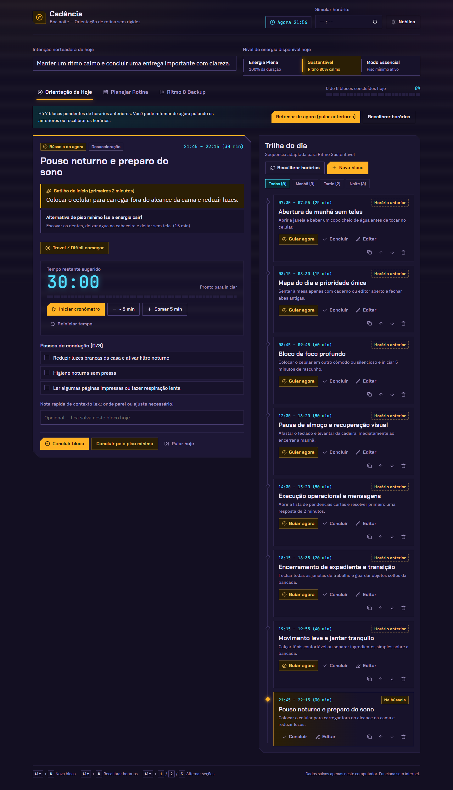

# Cadência — Orientação de Rotina Diária

Aplicativo desktop nativo para **Windows (100% offline)** e web de orientação de rotina diária, construído com **Electron 45 + React 19 + TypeScript 7 + Vite 8 + Vitest**, sob a direção visual **"Letreiro de Sódio"** (temas **Noturno** e **Neblina**).

Projetado para responder imediatamente *"Qual é meu próximo gesto agora?"*, destravar o início de atividades sem rigidez punitiva e adaptar o ritmo do dia conforme o nível real de energia.

---

## Prévia Visual

| Tema Noturno (Padrão — Desktop) | Tema Neblina (Claro — Desktop) |
| :---: | :---: |
|  |  |

---

## Principais Recursos

- **Bússola do Agora**: painel protagonista que destaca o bloco atual ou próximo, exibe o **Gatilho de Início (2 minutos)**, oferece **Alternativa de Piso Mínimo**, checklist de micro-passos e notas rápidas de contexto.
- **Assistente "Travei / Difícil começar"**: destravamento imediato com *Começar só por 2 min*, *Ponte de respiração (1 min)* ou *Usar piso mínimo neste bloco*.
- **Cronômetro Guiado sem Drift (`Date.now()`)**: mostrador estilo LCD com dígitos fantasma (`88:88`), mantém precisão mesmo em segundo plano, preserva a contagem ao navegar entre abas (com indicador ao vivo na aba), anuncia término de forma acessível (`aria-live="polite"`) e permite ajustes `- 5 min` / `+ 5 min`.
- **Adaptação por Energia do Dia**: chave de 3 posições entre *Energia Plena (100%)*, *Ritmo Sustentável (80%)* e *Modo Essencial (Piso Mínimo)*.
- **Retomada Gentil e Recalibração**: detecta blocos pendentes de horários anteriores oferecendo **Retomar de agora (pular anteriores)** ou **Recalibrar horários**, com suporte a **Desfazer** no toast.
- **Trilha do Dia & Detecção de Conflitos**: filtros por turno (*Manhã*, *Tarde*, *Noite*), alerta visual de sobreposição de horários, duplicação rápida, reordenação acessível por teclado e edição em modal `<dialog>` nativo.
- **Modelos, Leitura de Ritmo & Portabilidade JSON**: quatro modelos iniciais em português brasileiro, diagnóstico de carga e atrito por turno, histórico local automático na virada de dia e exportação/importação JSON sanitizada.
- **100% Offline e Seguro no Desktop**: fontes embarcadas localmente via `@fontsource` (`Chakra Petch`, `IBM Plex Sans`, `JetBrains Mono`), CSP restrita, `contextIsolation: true`, `sandbox: true` e bloqueio de requisições externas no processo principal do Electron.

---

## Atalhos de Teclado

| Atalho | Ação |
| :--- | :--- |
| `Alt + N` | Abrir modal de **Novo bloco** |
| `Alt + R` | **Recalibrar horários** a partir de agora |
| `Alt + 1` / `2` / `3` | Alternar entre **Orientação de Hoje**, **Planejar Rotina** e **Ritmo & Backup** |

---

## App Nativo (Windows, Offline)

O **Cadência** roda nativamente no Windows via Electron, sem acesso externo à rede. Todos os dados ficam salvos localmente neste computador.

```powershell
# Executar o app nativo em modo desenvolvimento (hot reload local)
npm run desktop:dev

# Compilar e abrir a janela nativa em produção local
npm run desktop

# Gerar pacote e instalador Windows (saída em release/)
npm run dist:win
```

Após `npm run dist:win`, os binários são gerados em `release/` (ignorados no Git):
- Instalador Windows (NSIS): `release/Cadencia-1.0.0-x64.exe`
- Executável desempacotado pronto para uso: `release/win-unpacked/Cadência.exe`

---

## Estrutura do Projeto

```text
orientador-rotina/
├── .agents/agents/        # Definições dos agentes Revisor e Editor
├── build/                 # Ícone SVG e PNG da aplicação desktop
├── docs/                  # Direção de arte, tokens, relatórios e histórico de melhorias
├── electron/              # Processo principal, preload e launcher dev do Electron
├── public/                # Favicon vetorial
├── qa/                    # Evidências de auditoria axe e capturas de tela (v1, v2, v3)
└── src/
    ├── components/        # HeaderBar, NowCompass, DayTimeline, BlockFormModal, RhythmAndPresetsView
    ├── data/              # Modelos iniciais de rotina em PT-BR
    ├── styles/            # Tokens semânticos (Noturno & Neblina) e folha de estilos
    ├── test/              # Suíte automatizada (Vitest + Testing Library)
    ├── types/             # Contratos TypeScript de rotina e bridge nativa
    └── utils/             # Motor de rotina, persistência/sanitização e hook de cronômetro
```

---

## Arquitetura de Agentes Especializados

Este projeto conta com dois agentes especializados em [`.agents/agents/`](./.agents/agents/) documentados em [`AGENTS.md`](./AGENTS.md):
- **Agente Revisor** ([`.agents/agents/agente-revisor.md`](./.agents/agents/agente-revisor.md)) → Relatório em [`docs/relatorio-revisor.md`](./docs/relatorio-revisor.md).
- **Agente Editor** ([`.agents/agents/agente-editor.md`](./.agents/agents/agente-editor.md)) → Registro de melhorias em [`docs/melhorias-editor.md`](./docs/melhorias-editor.md).

---

## Desenvolvimento e Verificação

```powershell
# Instalar dependências
npm install

# Iniciar servidor web local
npm run dev

# Verificação estática (oxlint)
npm run lint

# Suíte de testes automatizados (Vitest + Testing Library)
npm test

# Build de produção (TypeScript + Vite)
npm run build
```

---

## Licença

Projeto pessoal de código aberto. Consulte os detalhes de uso ou adapte livremente conforme sua rotina.
